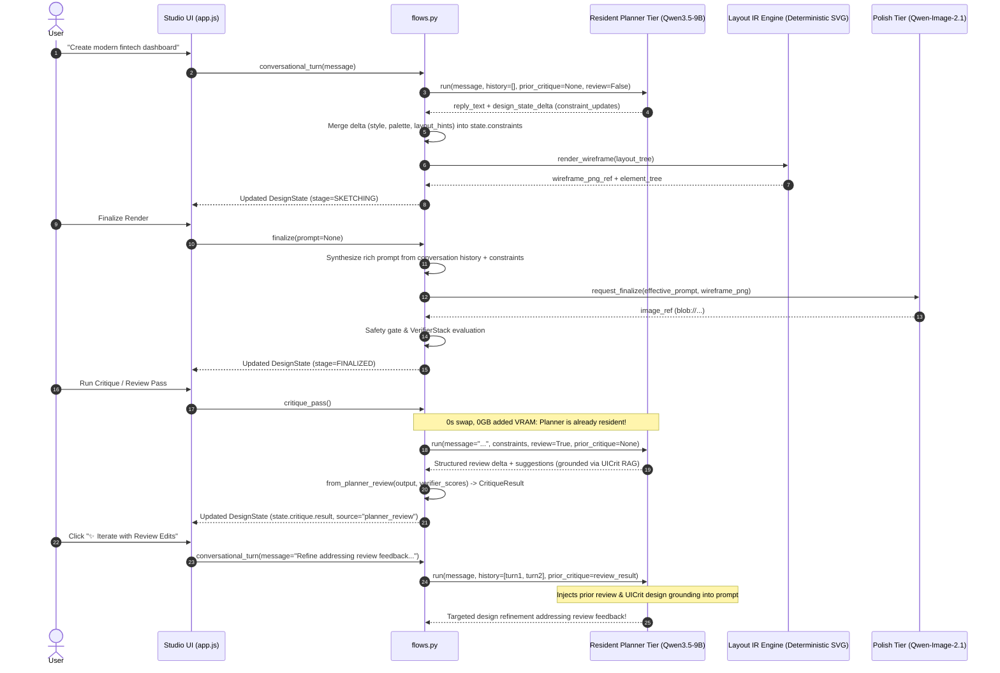

# Training ↔ Inference Synchronization & Agentic Architecture Design

> **Correction notice (2026-10-13).** The contracts below describe intended
> synchronization, not proof that every training path is executable. The
> Qwen-Image-2.1 trainer is external and unpinned in the current checkout,
> Planner review is currently text-only, and the current lock compositor is
> feathered rather than pixel-exact. Use
> [`docs/research/FINAL_ARCHITECTURE_VERDICT.md`](../research/FINAL_ARCHITECTURE_VERDICT.md)
> as the final train/freeze matrix, gate plan, and evidence standard. Any
> statement in this document that calls a pair corpus, memory number, or
> result “verified” is conditional on the receipts required there.

This document details the verified synchronization contracts between **Krisna's Training Pipeline** and **Inference Orchestration Subsystem**, aligned with PRD §5.1 (Design State), §5.2 (Critique Adapter), §5.3 (Sequence Flows), §6.1 (Model Tiers), and §7.4 (Residency State Machine).

---

## 1. Model Tier Synchronization & Weight Contracts (PRD §6.1)

Every tier in Krisna follows an explicit training-to-serving contract. Precision, checkpoint serialization, and vocabulary geometries match by construction:

```
[Training Pipeline]                                           [Inference Subsystem]
data-forge RICO+CLAY pairs ───────(wireframe, screenshot)─────> Layout IR Engine (Deterministic SVG/Pillow)
Diffusers DreamBooth LoRA ────────(Qwen-Image-2.1 LoRA: BF16)─> QwenImage21Backend (diffusers pipeline)
data-forge UICrit corpus ─────────(uicrit_critiques.jsonl)────> PlannerBackend (UICritRAGIndex)
Frozen upstream GGUF ─────────────(Qwen3.5-9B Q4_K_M)─────────> PlannerBackendLlama (llama.cpp mmap)
Resident Self-Critique ───────────(review=True mode)──────────> PlannerBackendLlama (0GB swap overhead)
```

| Tier | PRD Model | Training Status | Weight & Serialization Contract | Inference Backend |
|---|---|---|---|---|
| **Planner** | Qwen3.5-9B (Fast: 4B) | **Frozen** (RAG-only) | No fine-tuning. Grounded via UICrit sparse-dense RAG retrieval over human critique corpus. Grammar-constrained decoding (`krisna.delta.v1`). | `PlannerBackendLlama`: llama.cpp GGUF, 4-bit (6.5GB VRAM), always-resident. |
| **Layout IR (Sketch)** | Krisna Structured Layout IR | **Deterministic / Non-neural** | Pure JSON geometry schema (`krisna.layout.v1`). Lossless vector wireframe rendering via SVG/Pillow. (LayoutFlow TransformerEncoder is research-only). | `LayoutBackend`: Deterministic renderer (0.2GB VRAM), always-resident. |
| **Polish Default** | Qwen-Image-2.1 | **Trained (DreamBooth LoRA)** | Base model: `Qwen/Qwen-Image-2.1` (7B MMDiT). Fine-tuned via image-conditioned DreamBooth LoRA on synthesized (wireframe, screenshot) pairs. | `QwenImage21Backend`: Diffusers pipeline with LoRA adapter (12.0GB VRAM / 8.0GB low-VRAM CPU-offload). |
| **Polish Quality** | Qwen-Image-2.1 | **Frozen / High-step** | 40-step high-fidelity flow sampling with dynamic CFG and feathered region locking. | `QwenImage21Backend`: 16.0GB VRAM / 10.0GB low-VRAM CPU-offload (fallback: Default). |
| **Critic** | **RETIRED** (was Gemma 4 31B) | **REMOVED** | Subprocess Gemma-4 eliminated due to 18GB VRAM footprint and 45s cold-load latency. | **Replaced by Resident Planner Review** (`review=True` mode): 0GB added VRAM, 0s swap latency. |

---

## 2. Design State & Structured Schemas (PRD §5.1, §5.2)

All model tiers communicate via the centralized `DesignState` object managed by `DesignStateStore` with optimistic concurrency (`revision` counter guard).

### A. Constraints Schema (PRD §5.1)
```python
class Constraints(BaseModel):
    style: str | None = None
    palette: list[str] = Field(default_factory=list)  # Hex color codes
    layout_hints: str | None = None
    locked_regions: list[LockedRegion] = Field(default_factory=list)
```

### B. Critique Result Schema (PRD §5.2)
```python
class CritiqueDimensionScore(BaseModel):
    score: float
    note: str = Field(default="", max_length=280)

class CritiqueResult(BaseModel):
    critique_source: str
    overall_score: float
    dimensions: dict[str, CritiqueDimensionScore]
    suggested_edits: list[dict[str, Any]]  # [{"region": str | list, "instruction": str}]
    raw_model_output_ref: str | None = None
```

---

## 3. Sequence Flows & Context Propagation (PRD §5.3)



### Key Synchronization Mechanics:

1. **Multi-Turn Context Forwarding**:
   - `flows.conversational_turn` snapshots `conversation_history` before appending the current turn, forwarding prior turns to `orchestrator.run_conversational_turn`.
   - `PlannerBackendLlama` injects up to the last 6 turns into Qwen's chat template (`role="user"` and `role="assistant"`).
   - `cli.py` (`krisna-session`) also accumulates turns in loop execution.

2. **Planner JSON Delta Constraint Merging**:
   - Planner produces a trailing JSON object conforming to `krisna.delta.v1`:
     `{"schema_version": "krisna.delta.v1", "reply_text": "...", "design_state_delta": {"constraint_updates": {...}}, "retrieved_critique_ids": [...]}`
   - `flows.conversational_turn` parses this delta and directly updates `state.constraints.style`, `state.constraints.palette`, `state.constraints.layout_hints`, and `state.constraints.locked_regions`.

3. **Resident Review Feedback Loop Closure**:
   - When critique completes, `state.critique.result` holds the structured review normalized by `from_planner_review()`.
   - Subsequent calls to `conversational_turn` pass `prior_critique` to `PlannerBackendLlama.run`.
   - `PlannerBackendLlama._prompt` formats overall score, dimension notes, and itemized suggested edits directly into the system prompt alongside UICrit retrieved notes.

4. **Deterministic Layout IR Grounding**:
   - `LayoutBackend` parses the hierarchical UI element tree and generates a lossless 2D SVG/PNG wireframe, guaranteeing 100% geometric repeatability without token quantization artifacts.

5. **PE-Style Descriptive Prompt Synthesis & Verbatim Label Guard**:
   - `synthesize_descriptive_polish_prompt()` transforms raw layout constraints into cohesive descriptive prose matching Qwen Prompt Enhancement (PE) format across header, cards, action bars, and styling.
   - `assert_and_inject_verbatim_labels()` acts as an enforceable guard guaranteeing 100% survival of text labels from `LayoutIR` before passing to the diffusion pipeline.

6. **Refinement Mode Dual-Image Visual Conditioning & FlowEdit**:
   - In refinement turns, Polish conditions on **both images in fixed block-causal order**: `[updated_wireframe_png, prior_render_png]`.
   - Token budget: $2 \times 4096$ condition image tokens ($8,192$) $+ 4096$ target latents $+ \le 512$ text prompt tokens $\approx 12,800$ tokens ($\approx 12.8\text{K}$ tokens).
   - `iterative_refine` immediately re-renders the wireframe to `state.layout.wireframe_ref` upon VLA action execution, and locks photorealistic regions from the prior render (`lock_donor_ref`) for 0.00% pixel drift.

7. **Grounded Regional Spatial Retry Feedback & Seam Gating**:
   - `build_grounded_spatial_retry_prompt()` translates numeric drift into natural-language regional spatial directives referencing specific buttons, headers, and labels.
   - Closed-loop verification enforces `seam_continuity >= 0.85` in `EVALUATION_TARGETS`; locked-locked node conflicts are detected in `LayoutIR.diagnostics` and surfaced to `state.conversation_history` as `[Layout Conflict]`.

8. **Single-Stream DiT LoRA Architecture Invariant**:
   - Targets all 7 Single-Stream DiT linear projections: attention (`to_q, to_k, to_v, to_out.0`) and SwiGLU MLP (`img_mlp.gate_layer, img_mlp.proj, img_mlp.out`) across 32 transformer blocks ($7 \times 32 = 224$ modules total).
   - Enforced by a strict fail-fast assertion in `train_dpo.py` (`assert len(_matched_lora_modules) == 224`).

---

## 4. VRAM Envelopes & State Machine (PRD §7.4)

> [!NOTE]
> All memory figures below represent **Documented Architecture Estimates / Unmeasured (Code-Level Invariants)** pending physical GPU hardware profiling.

Baseline residency maintains **Planner (Q4_K_M: 6.5GB)** + **Layout IR (0.2GB)** = **6.7GB VRAM**, comfortably within the 10GB resident ceiling:

- **Conversational Turn**: Zero swaps. Always-resident high throughput.
- **Review / Critique Pass**: **Zero swaps, 0GB added memory**. Runs directly on resident Planner (`review=True`) with zero cold-load latency (eliminates old 45s Gemma swap).
- **Finalize**: Planner + Layout IR temporarily unloaded; Polish tier loaded (`POLISH_DEFAULT` 8–12GB / `POLISH_QUALITY` 10–16GB). Output generated, verifiers scored, baseline restored.
- **Low-VRAM Envelope & Sequential Swapping**: On a 12GB consumer GPU, Planner (5.5–6GB) and Polish (5.5–6GB NF4 with CPU offload) cannot reside concurrently. Krisna's `SwapOrchestrator` performs **sequential model swapping** via `enable_model_cpu_offload()` and host RAM staging ($\ge 32\text{GB}$ host RAM recommended), trading PCI-e swap latency for single-GPU 12GB feasibility.
