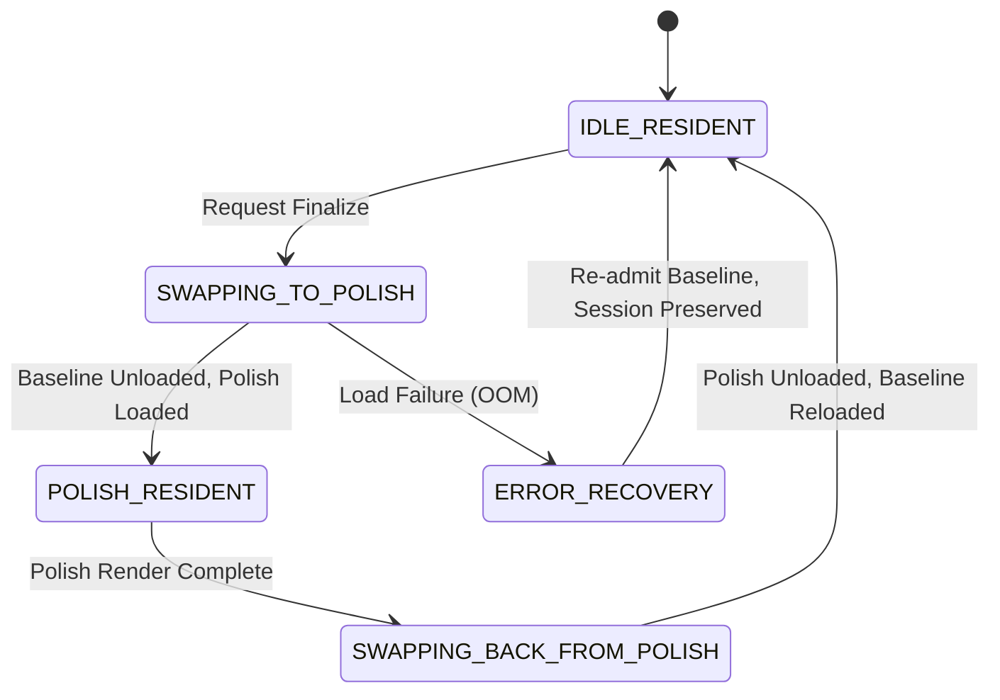

# Krisna Inference & Serving Architecture

Comprehensive reference for consumer GPU serving, swap orchestration, and multi-turn agentic flows under the modernized architecture.

> [!IMPORTANT]
> **Canonical Specification**: Defined in [docs/PRD.md §5](../PRD.md#5-data-model--core-flows) (Data Model & Core Flows) and [docs/PRD.md §7](../PRD.md#7-inference-orchestration) (Inference Orchestration).
> The modernized architecture strictly preserves a **12GB VRAM consumer target envelope** with a clear single-model-per-responsibility division:
> - **Planner Tier**: Frozen `llama.cpp` runtime with quantized GGUF weights (~6.5GB VRAM) and versioned JSON delta (`krisna.planner.v1`).
> - **Sketch Tier**: Structured Layout IR (`krisna.layout.v1`) and deterministic wireframe renderer (~0.2GB VRAM).
> - **Polish Tier**: Unified `Qwen-Image-2.1` diffusion pipeline with verified DreamBooth LoRA adapter and low-VRAM CPU offload (8.0–12.0GB VRAM).
> - **Review/Critique**: Executed directly against the resident Planner in review mode (zero swap, zero second VLM).

---

## 1. System Pipeline Architecture

```
User Intent (Chat Turn)
       │
       ▼
┌────────────────────────────────────────────────────────┐
│ Tier A: Baseline (Always Resident, ~6.7GB VRAM)        │
│  - Planner Backend (Qwen3.5-9B GGUF via llama.cpp)     │
│  - Sketch Backend (Structured Layout IR + Renderer)    │
└────────────────────────────────────────────────────────┘
       │                                  │
       ▼ (User requests Finalize)         ▼ (Self-Review / Critique)
┌────────────────────────────────┐  ┌────────────────────────────────┐
│ Tier B: Polish Tier (Swapped)  │  │ Planner Review Mode (Resident) │
│  - Qwen-Image-2.1 Pipeline     │  │  - Zero GPU swap required      │
│  - DreamBooth LoRA Adapter     │  │  - Visual & layout inspection  │
│  - Standard 28 / Quality 40 St │  │  - Targeted constraint updates │
│  - Verifier Stack Safety Gate  │  └────────────────────────────────┘
└────────────────────────────────┘
       │
       ▼
Orchestrator unloads Polish Tier,
re-admits Baseline Tier, returns to IDLE_RESIDENT.
```

---

## 2. Residency State Machine (PRD §7.4)

Verified transition table implemented in `krisna_inference.orchestrator.state_machine`:



*Note: Self-review and visual critique operate directly in `IDLE_RESIDENT` against the resident Planner without triggering GPU swap overhead.*

---

## 3. Resource Ledgers & Envelopes (PRD §3, §7.2, §7.3)

Admission is deterministic and CI-tested, governed by `VRAMLedger` and `RAMLedger` against declared budgets:

| Tier | Full Envelope (24GB Target) | Low-VRAM Envelope (12GB Target) | Offload Mechanism |
|---|---|---|---|
| **Planner** (Always Resident) | 6.5 GB VRAM / 0 GB RAM | 6.5 GB VRAM / 0 GB RAM | Pinned llama.cpp GGUF 4-bit |
| **Sketch** (Always Resident) | 0.2 GB VRAM / 0 GB RAM | 0.2 GB VRAM / 0 GB RAM | Deterministic Layout Renderer |
| **Polish-Default** (Qwen-Image-2.1) | 12.0 GB VRAM / 0 GB RAM | 8.0 GB VRAM / 8.0 GB RAM | Diffusers `enable_model_cpu_offload()` |
| **Polish-Quality** (Qwen-Image-2.1) | 16.0 GB VRAM / 0 GB RAM | 10.0 GB VRAM / 10.0 GB RAM | Diffusers `enable_model_cpu_offload()` |

---

## 4. Multi-Turn Agentic Feedback Loop & Refinement Budget

1. **Context & Intent Preservation**:
   - Every `POST /session/{id}/message` carries cumulative `conversation_history` into the Planner backend.
   - Initial intent is locked in `constraints.original_intent` to prevent drift across extended dialogues.
2. **Dynamic Constraints Merging**:
   - Structured JSON output emitted by the Planner is parsed against `krisna.planner.v1`.
   - `constraint_updates` (style, palette, layout_hints, and `locked_regions: [{bbox, reason}]`) are merged into `DesignState.constraints`.
3. **Structured Layout Handoff**:
   - Layout IR is persisted to `state.layout.layout_ref` (`.json`) with SVG/PNG wireframes (`.png`) saved to the blob store.
   - Finalize takes wireframe input and transforms it into polished visuals via image conditioning.
4. **Autonomous Self-Review & Turn Budget**:
   - `RefinementBudget` enforces a strict turn cap (default 5 turns) with monotonic turn counters and exhaustion detection.
   - Planner self-review inspects layout hierarchy, typography, and contrast, updating constraints before final rendering.

---

## 5. REST API Endpoints

FastAPI service exposed on default port `8420`:

| Method | Route | Description |
|---|---|---|
| `GET` | `/health` / `/healthz` | Liveness & readiness probes (residency state and VRAM snapshot). |
| `GET` | `/hardware` | Live hardware telemetry (GPU, driver, CUDA, free/total VRAM, and config status). |
| `POST` | `/session` | Initializes a new `DesignState` session with `RefinementBudget`. |
| `GET` | `/session/{id}` | Retrieves active `DesignState` snapshot. |
| `POST` | `/session/{id}/message` | Advances conversational turn (Planner + Layout IR pass). |
| `POST` | `/session/{id}/review` | Runs bounded autonomous Planner self-review. |
| `POST` | `/session/{id}/finalize` | Initiates tier swap, feeds wireframe to Qwen-Image-2.1, scores verifiers. |
| `POST` | `/session/{id}/critique` | Evaluates finalized render using resident Planner review mode. |
| `GET` | `/session/{id}/render` | Streams raw finalized image bytes (`image/png`). |
| `GET` | `/orchestrator/status` | Reports residency state, declared ledgers, and live hardware probes. |
