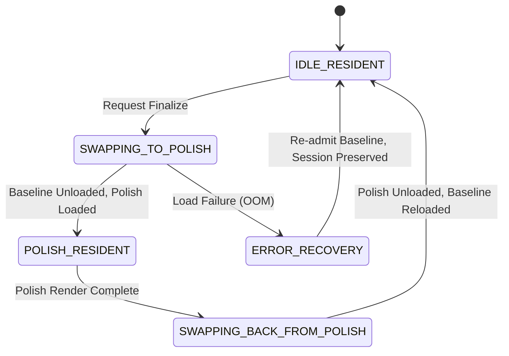

# Krivex Inference & Serving Architecture

Comprehensive reference for consumer GPU serving, swap orchestration, and multi-turn agentic flows under the modernized architecture.

> [!IMPORTANT]
> **Canonical Specification**: Defined in [docs/PRD.md §5](../PRD.md#5-data-model--core-flows) (Data Model & Core Flows), [docs/PRD.md §7](../PRD.md#7-inference-orchestration) (Inference Orchestration), and [docs/RESEARCH_PAPER.md §9](../RESEARCH_PAPER.md#9-ml-systems-serving-foundations-computational-complexity-memory-bounds-and-zero-eviction-serving-dynamics) (Systems Serving Foundations & Zero-Eviction Dynamics).
> The modernized architecture strictly preserves a **12GB VRAM / 16GB RAM consumer target envelope** with a clear single-model-per-responsibility division:
> - **Planner Tier**: Pinned `Qwen3.5-9B-Instruct` GGUF (`Q4_K_M`) with strictly required multimodal projector (`Qwen3.5-9B-Instruct-mmproj-f16.gguf`) via `llama.cpp` (and opt-in `vllm==0.29.0`). Emits typed schema deltas (`krivex.delta.v1` / `planner.delta.v1`) with GBNF grammar pushdown automata constraints.
> - **Sketch Tier**: Structured Layout IR (`krivex.layout.v1`) and deterministic Cassowary Simplex engine rendering dual-stream spatial conditioning (`DualStreamSketch`: wireframe + 16-class SPADE semantic map) on host SIMD (**0.0 GB VRAM**, <5ms).
> - **Polish Tier**: `Qwen-Image-2.1` native continuous flow-matching MMViT pipeline (7B parameters); base foundation model is frozen, conditioned on dual-stream spatial tensors, and accelerated with continuous-flow UI Polish LoRA adapters (`krivex-ai/krivex-qwen-image21-polish-lora`). Low-VRAM CPU offload and NF4 quantization bound peak active synthesis to $\le 12$ GB VRAM and $\le 16$ GB RAM.
> - **Review/Critique**: Planner self-review is resident and zero-swap ($T_{\text{swapping}} \equiv 0.000\text{s}$), paired with post-generation automated verifiers (Layout-IoU, EasyOCR readability, and ONNX Safety Gate).

---

## 1. System Pipeline Architecture

```
User Intent (Chat Turn)
       │
       ▼
┌────────────────────────────────────────────────────────┐
│ Tier A: Baseline (Always Resident, ~4.4GB VRAM)        │
│  - Planner Backend (Qwen3.5-9B GGUF + mmproj)          │
│  - Sketch Backend (Cassowary Simplex Engine, 0 MB VRAM)│
└────────────────────────────────────────────────────────┘
       │                                  │
       ▼ (User requests Finalize)         ▼ (Resident Self-Review)
┌────────────────────────────────┐  ┌────────────────────────────────┐
│ Tier B: Polish Tier (Swapped)  │  │ Planner Review Mode (Resident) │
│  - Qwen-Image-2.1 MMViT Flow   │  │  - Zero GPU swap required      │
│  - UI Polish LoRA Adapter      │  │  - Visual & layout inspection  │
│  - Multi-Fidelity ODE (6-40 St)│  │  - Targeted constraint updates │
│  - Verifier Stack Safety Gate  │  └────────────────────────────────┘
└────────────────────────────────┘
       │
       ▼
Orchestrator unloads Polish Tier,
re-admits Baseline Tier, returns to IDLE_RESIDENT.
```

---

## 2. Residency State Machine (PRD §7.4)

Verified transition table implemented in `krivex_inference.orchestrator.state_machine`:



*Note: self-review operates in `IDLE_RESIDENT` via the resident `Qwen3.5-9B` VLM with `mmproj`. Finalized pixels are scored by
the verifier stack after generation; this is not a claim that the resident
Planner receives an image-grounded critique request.*

---

## 3. Resource Ledgers & Envelopes (PRD §3, §7.2, §7.3 & Research Paper §9.2)

Admission is deterministic and CI-tested, governed by `VRAMLedger` and `RAMLedger` against declared budgets:

| Tier | Full Envelope (24GB Target) | Low-VRAM Envelope (12GB Target) | Offload Mechanism |
|---|---|---|---|
| **Planner** (Always Resident) | 6.5 GB VRAM / 0 GB RAM | 4.2–4.4 GB VRAM / 0 GB RAM | Pinned llama.cpp GGUF Q4_K_M + mmproj |
| **Sketch** (Always Resident) | **0.0 GB VRAM** / 0.1 GB RAM | **0.0 GB VRAM** / 0.1 GB RAM | Pure host SIMD Cassowary Linear Simplex |
| **Polish-Default** (Qwen-Image-2.1) | 12.0 GB VRAM / 0 GB RAM | 8.0 GB VRAM / 8.0 GB RAM | Diffusers `enable_model_cpu_offload()` + NF4 |
| **Polish-Quality** (Qwen-Image-2.1) | 16.0 GB VRAM / 0 GB RAM | 10.0 GB VRAM / 10.0 GB RAM | Diffusers `enable_model_cpu_offload()` + VAE tiling |

---

## 4. Multi-Turn Agentic Feedback Loop & Refinement Budget

1. **Context & Intent Preservation**:
   - Every `POST /session/{id}/message` carries cumulative `conversation_history` into the Planner backend.
   - Initial intent is locked in `constraints.original_intent` to prevent drift across extended dialogues.
2. **Dynamic Constraints Merging**:
   - Structured JSON output emitted by the Planner is parsed against `krivex.planner.v1`.
   - `constraint_updates` (style, palette, layout_hints, and `locked_regions: [{bbox, reason}]`) are merged into `DesignState.constraints`.
3. **Structured Layout Handoff**:
   - Layout IR is persisted to `state.layout.layout_ref` (`.json`) with SVG/PNG wireframes (`.png`) saved to the blob store.
   - Finalize takes wireframe input and transforms it into polished visuals via image conditioning.
4. **Autonomous Self-Review & Turn Budget**:
    - `RefinementBudget` enforces a strict turn cap (default 4 turns) with monotonic turn counters and exhaustion detection.
   - Planner self-review inspects layout hierarchy, typography, and contrast, updating constraints before final rendering.

---

## 5. REST API Endpoints

FastAPI service exposed on default port `8420`:

| Method | Route | Description |
|---|---|---|
| `GET` | `/health` | Liveness plus explicit `ready` and `backend_mode` fields. |
| `GET` | `/ready` | Readiness only after baseline Planner + Layout residency is complete. |
| `POST` | `/session` | Initializes a new `DesignState` session with `RefinementBudget`. |
| `GET` | `/session/{id}` | Retrieves active `DesignState` snapshot. |
| `POST` | `/session/{id}/message` | Advances conversational turn (Planner + Layout IR pass). |
| `POST` | `/session/{id}/self-review` | Runs bounded autonomous Planner self-review. |
| `POST` | `/session/{id}/finalize` | Initiates tier swap, feeds wireframe to Qwen-Image-2.1, scores verifiers. |
| `POST` | `/session/{id}/critique` | Runs critique/verifier flow and records eligible evidence. |
| `GET` | `/session/{id}/render` | Streams raw finalized image bytes (`image/png`). |
| `GET` | `/orchestrator/status` | Reports residency state, declared ledgers, and live hardware probes. |
